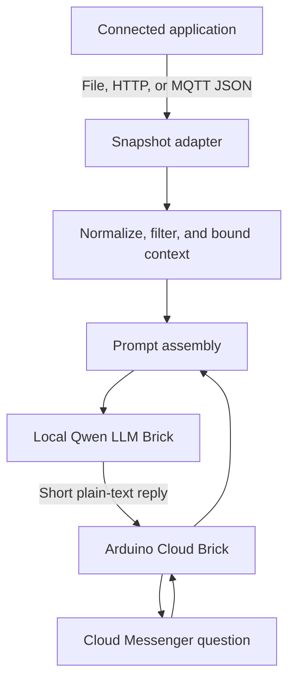
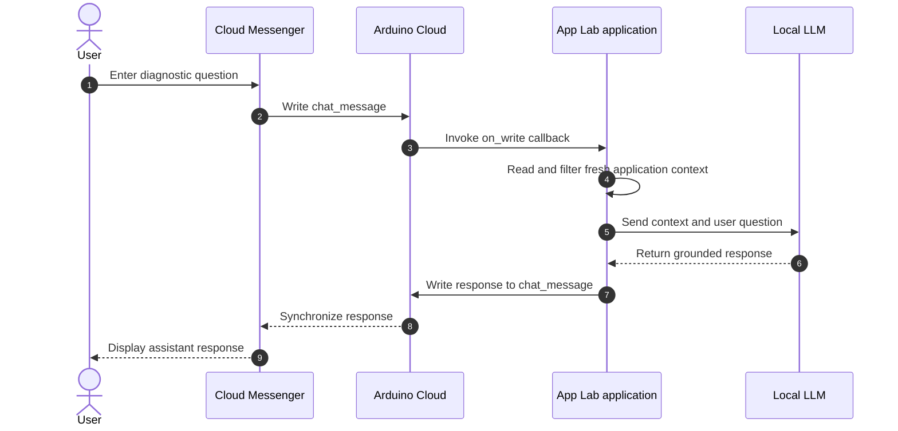

# VENTUNO Q Cloud LLM Diagnostics

A parameter-agnostic diagnostic chat service for applications connected to an
Arduino VENTUNO Q. The application reads a local diagnostic snapshot, gives it
to an on-device Qwen LLM, and exposes the conversation through an Arduino Cloud
Messenger widget.

The project contains only the diagnostic chat path. It does not include the
original application's sensors, business rules, dashboard, or customer data.

## What it does

- Reads diagnostic data from a JSON file, an HTTP JSON endpoint, or an MQTT
  topic.
- Accepts any nested JSON object; no fixed list of parameters is required.
- Supports an optional richer schema with labels, units, ranges, status, and
  recent events.
- Removes common secret fields before the snapshot is added to the LLM prompt.
- Marks missing or stale data so the model does not present old values as live.
- Runs Qwen 3-4B Instruct locally through the App Lab LLM Brick.
- Uses one Arduino Cloud `String` variable for both Messenger questions and
  short assistant responses.

## Architecture



### Conversation sequence



The App Lab application reads the diagnostic source only after a question is
received. This keeps the answer grounded in the latest available application
state while avoiding continuous diagnostic payload uploads to Arduino Cloud.

The diagnostic snapshot remains local to the VENTUNO Q. Arduino Cloud carries
only the user's question and the assistant's final short response.

| Processing step | Runs on | Data handled |
| --- | --- | --- |
| Read application state | VENTUNO Q Linux side | Local JSON snapshot |
| Filter and format context | Python on the VENTUNO Q | Selected diagnostic fields |
| LLM inference | App Lab LLM Brick using the `genie:` model runtime | Context plus question |
| Conversation transport | Arduino Cloud Brick | User question and short reply only |
| Conversation display | Arduino Cloud Messenger widget | The shared `chat_message` variable |

## Repository layout

```text
ventuno-q-cloud-llm-diagnostics/
├── app.yaml                    App Lab Bricks and local model
├── config/diagnostics.json     Data source, chat, and privacy settings
├── examples/
│   ├── http_status_server.py   Optional local test endpoint
│   └── status.json             Example diagnostic snapshot
├── python/
│   ├── diagnostics.py          Normalization, redaction, and context builder
│   ├── main.py                 Cloud Messenger and local LLM integration
│   ├── requirements.txt
│   └── sources.py              File, HTTP, and MQTT adapters
├── sketch/                     Minimal App Lab MCU project
└── tests/test_diagnostics.py   Host-side unit tests
```

## Data contract

### Option A: existing arbitrary JSON

The service can read an ordinary nested JSON object without an application
change:

```json
{
  "machine": {
    "state": "running",
    "speed_rpm": 1200,
    "temperature_c": 64.2
  },
  "network": {
    "connected": true
  }
}
```

Nested values are flattened into diagnostic paths such as
`machine.temperature_c`. Keys matching the configured secret patterns are
discarded.

### Option B: recommended diagnostic schema

Use this schema when the connected application can provide metadata. It gives
the LLM clearer units, expected ranges, and severity:

```json
{
  "source": "application-name",
  "timestamp": "2026-11-18T20:00:00Z",
  "status": "warning",
  "parameters": {
    "motor_temperature": {
      "label": "Motor temperature",
      "value": 72.4,
      "unit": "C",
      "status": "warning",
      "normal_range": [10, 70],
      "message": "Above preferred operating range"
    }
  },
  "events": [
    {
      "severity": "warning",
      "message": "Motor temperature crossed the preferred limit"
    }
  ]
}
```

Use an ISO 8601 UTC timestamp. The app compares it with the current time and
labels the snapshot as fresh or stale.

## Configure the data source

Edit `config/diagnostics.json`. The included configuration reads
`examples/status.json`.

### JSON file

Use this when another local process writes a complete snapshot atomically:

```json
"source": {
  "type": "file",
  "path": "/var/lib/my-application/status.json"
}
```

### HTTP endpoint

Use an endpoint on the board or a reachable device:

```json
"source": {
  "type": "http",
  "url": "http://127.0.0.1:8080/status",
  "timeout_seconds": 3
}
```

To exercise the included endpoint, run:

```bash
python3 examples/http_status_server.py
```

Then select the HTTP configuration above.

### MQTT topic

The topic must publish one complete JSON snapshot per message. A retained
message lets the assistant answer immediately after it starts.

```json
"source": {
  "type": "mqtt",
  "host": "127.0.0.1",
  "port": 1883,
  "topic": "applications/diagnostics/snapshot"
}
```

Do not commit MQTT credentials to the repository. Keep the broker local or use
deployment-specific configuration with restricted permissions.

## Deploy in Arduino App Lab

1. Clone or download this repository.
2. Import the `ventuno-q-cloud-llm-diagnostics` folder into Arduino App Lab on
   the target VENTUNO Q.
3. Open `config/diagnostics.json` and select the local application data source.
4. In App Lab settings, connect and provision the board for Arduino Cloud.
5. Install the Bricks and model declared in `app.yaml` if App Lab prompts for
   them.
6. Run the App and confirm the console reports:

   ```text
   Diagnostic chat is ready on Arduino Cloud variable 'chat_message'
   ```

The `genie:qwen3_4b_instruct_2507` entry selects the local Qwen model runtime.
Python performs source I/O, filtering, and prompt assembly; the LLM Brick owns
model execution.

## Configure Arduino Cloud Messenger

1. Open the Arduino Cloud Thing linked to the VENTUNO Q.
2. Confirm that it has a `String` variable named `chat_message`.
3. Set the variable permission to **Read & Write** and its update policy to
   **On change**.
4. Open or create a Cloud dashboard.
5. Add a **Messenger** widget.
6. Link the widget to `chat_message`.
7. Send a question such as `What is abnormal right now?`

The widget writes the question to `chat_message`. The Cloud Brick invokes
`on_chat_message()`, the board reads the newest local snapshot and runs the
local LLM, and the board writes the reply to the same variable. A loop guard
prevents that reply from being treated as another user question.

## Payload behavior

No sensor payload is sent to Arduino Cloud by this project. For each exchange:

1. Cloud sends the Messenger question to the board as a `String`.
2. The board reads and filters the application snapshot locally.
3. The board supplies the local context and question to the local LLM.
4. The board returns a plain-text reply capped at 220 characters by default.

Change the limits in `config/diagnostics.json` if the Cloud variable or target
model requires different bounds.

## Privacy controls

`privacy.deny_key_patterns` removes likely credentials such as passwords,
tokens, API keys, and private keys. `privacy.allow_paths` is empty by default,
which permits all non-denied diagnostic paths. For stricter deployments, add
only the paths the model may inspect, for example:

```json
"privacy": {
  "allow_paths": [
    "parameters.temperature",
    "parameters.supply_voltage"
  ],
  "deny_key_patterns": [
    "password",
    "token",
    "secret",
    "api_key"
  ]
}
```

The deny list is a safeguard, not a substitute for keeping secrets out of the
diagnostic endpoint.

## Run the host-side tests

The context tests do not require the Arduino Bricks:

```bash
cd ventuno-q-cloud-llm-diagnostics
python3 -m unittest discover -s tests -v
```

## Adapt a new application

For most integrations, no Python changes are necessary:

1. Expose one current JSON snapshot through a file, HTTP endpoint, or MQTT
   topic.
2. Include a current `timestamp` and use the richer `parameters` schema when
   units and normal ranges are known.
3. Point `config/diagnostics.json` at the source.
4. Add an allowlist if the source contains unrelated fields.
5. Test questions for normal, warning, stale, and missing-data conditions.

If another transport is required, implement `SnapshotSource.read()` in
`python/sources.py` and add it to `create_source()`. The Cloud and LLM code does
not need to change.

## Scope and limitations

- The model explains only the snapshot it receives; it does not replace
  application safety logic or operator procedures.
- The example uses one shared Messenger variable, so it is intended for one
  conversational stream per Thing.
- Reply length is deliberately conservative for Cloud Messenger transport.
- Validate the configured model and App Lab release against the target VENTUNO
  Q software image before production deployment.

## References

- [Arduino App Lab documentation](https://docs.arduino.cc/software/app-lab/)
- [Local AI Voice Assistant with the VENTUNO Q](https://docs.arduino.cc/tutorials/ventuno-q/local-ai-assistant)
- [Arduino Cloud documentation](https://docs.arduino.cc/arduino-cloud/)
