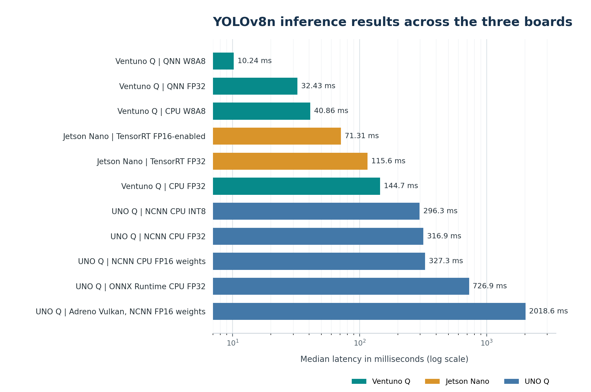
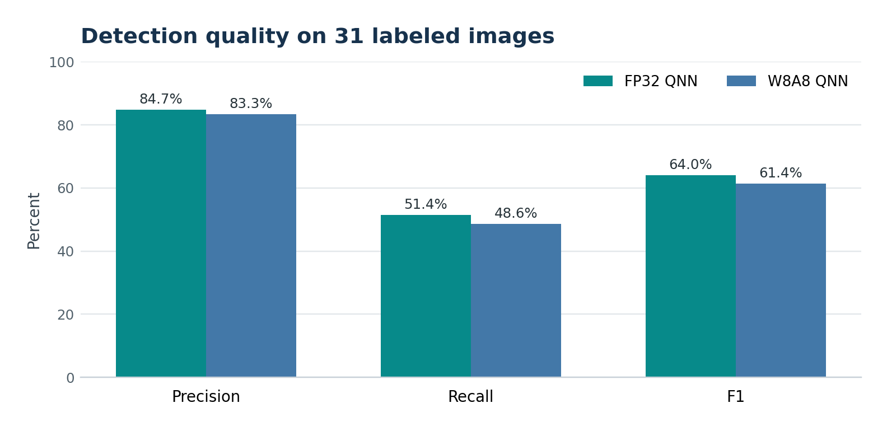
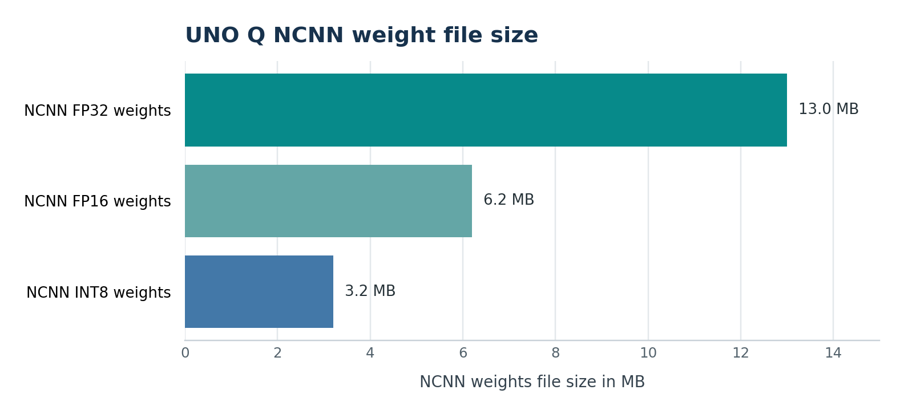

# Edge AI Benchmark: YOLOv8n on Ventuno Q, Jetson Nano, and UNO Q

This repository records a pilot porting and inference study using the same YOLOv8n model family at a batch size of 1 and a 640 × 640 input. It documents the deployment workflows, measured latency, pilot detection quality, file-size comparisons, and the limits of the current comparison.

## Headline result

On Ventuno Q, the corrected W8A8 model ran through Qualcomm QNN with a **10.24 ms median inference latency**, compared with **32.43 ms** for the QNN FP32 path: **3.17× faster** in this setup. On 31 labeled images, W8A8 F1 was 61.40% versus 63.98% for FP32. This is an encouraging model-specific result, not a guarantee for other customer models.

## Results at a glance

| Platform and path | Precision / runtime | Median latency | Notes |
|---|---|---:|---|
| Ventuno Q | QNN FP32 | 32.43 ms | Qualcomm NPU path observed in ONNX Runtime profile |
| Ventuno Q | QNN W8A8 | 10.24 ms | Corrected split-output quantized model |
| Ventuno Q | CPU FP32 | 144.73 ms | CPU-only baseline |
| Ventuno Q | CPU W8A8 | 40.86 ms | Same quantized model on CPU |
| Jetson Nano | TensorRT FP32 | 115.60 ms | Loaded engine, end-to-end median from `trtexec` |
| Jetson Nano | TensorRT FP16-enabled | 71.31 ms | TensorRT may keep unsupported layers in FP32 |
| UNO Q | NCNN CPU FP32 | 316.87 ms | Four CPU threads |
| UNO Q | NCNN CPU INT8 | 296.34 ms | Four CPU threads; pilot speedup 6.5% |
| UNO Q | NCNN CPU, FP16 weights | 327.28 ms | Model weights stored as FP16 |
| UNO Q | NCNN Adreno Vulkan, FP16 weights | 2,018.56 ms | Exploratory run; no per-layer placement profile |
| UNO Q | ONNX Runtime CPU FP32 | 726.86 ms | CPU execution provider; no QNN provider available in this setup |

These numbers are useful as **within-platform precision comparisons**. They are not a controlled cross-platform ranking: timing boundaries, input values, runtimes, and measurement methods differed. See [measurement notes](docs/benchmark-procedure.md).

## Visual summary

## What's in this repository

- [`docs/benchmark-procedure.md`](docs/benchmark-procedure.md) — setup, conversion, quantization, timing, quality evaluation, and rerun guidance.
- [`benchmarks/`](benchmarks/) — runnable timing scripts for ONNX Runtime/QNN, NCNN, and Jetson TensorRT.
- [`aihub/`](aihub/) — ONNX output splitting, AI Hub calibration quantization, and target compilation scripts.
- [`aihub/requirements.txt`](aihub/requirements.txt) and [`benchmarks/requirements-ncnn.txt`](benchmarks/requirements-ncnn.txt) — Python dependencies for those workflows.
- [`results/latency.csv`](results/latency.csv) — measured latency summaries and measurement boundaries.
- [`results/ventuno-quality.csv`](results/ventuno-quality.csv) — pilot ground-truth metrics and FP32 agreement result.
- [`results/model-sizes.csv`](results/model-sizes.csv) — model weight / engine sizes that were recorded.
- [`docs/YOLOv8n_Edge_AI_Benchmark_Commercial_Report.docx`](docs/YOLOv8n_Edge_AI_Benchmark_Commercial_Report.docx) — formatted sales-facing report.
- [`figures/`](figures/) — source graphs embedded in the report.

## Interpretation

The Ventuno Q result demonstrates a working path from a PyTorch/ONNX model to AI Hub quantization and target compilation, followed by on-device QNN execution and accuracy checks. A customer should provide the checkpoint or ONNX graph and weights; a prebuilt TensorRT engine or custom CUDA kernels are not directly portable deployment inputs.

The proposed “NPU vision while CPU/GPU runs an LLM” message remains **untested**. A follow-up concurrency run should measure vision latency and throughput before/during LLM generation, LLM tokens per second, temperature, and power over a sustained interval.

## Reproduce and extend

Follow the procedure in [`docs/benchmark-procedure.md`](docs/benchmark-procedure.md) and use the scripts in `benchmarks/` and `aihub/`. Model binaries, datasets, credentials, and runtime profiles are intentionally excluded from version control. Do not commit AI Hub tokens or customer model assets.

## Model and tool references

- Ultralytics YOLOv8: <https://github.com/ultralytics/ultralytics>
- Qualcomm AI Hub: <https://aihub.qualcomm.com/>
- NCNN: <https://github.com/Tencent/ncnn>
- PNNX conversion guide: <https://github.com/Tencent/ncnn/wiki/use-ncnn-with-pytorch-or-onnx>
- NCNN INT8 quantization guide: <https://github.com/Tencent/ncnn/wiki/quantized-int8-inference>
- NVIDIA TensorRT: <https://developer.nvidia.com/tensorrt>
